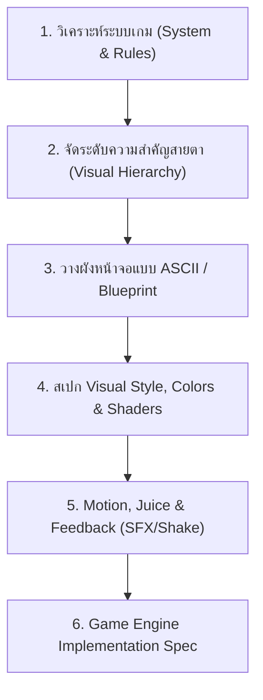

# Anime Game UI & Combat HUD Design

สกิลนี้ออกแบบมาเพื่อเติมเต็มช่องว่างระหว่าง **Web/App UI ธรรมดา** กับ **Game UI สไตล์อนิเมะ RPG/แฟนตาซี/ไซไฟ**
เน้นการสร้าง UI ที่มีอารมณ์ร่วม (Juiciness), ระบบ Diegetic UI (UI ที่เป็นส่วนหนึ่งของโลกในเกม เช่น แอปแกน, ตราเวทมนตร์), และสเปกสำหรับนำไปพัฒนาใน Game Engine (Godot, Unity, หรือ WebGL/Canvas)

---

## 1. ขอบเขตและหน้าที่ของสกิล

| หมวด | สิ่งที่ทำ | ตัวอย่างในโปรเจกต์นี้ |
|---|---|---|
| **Combat HUD** | ตัวนับคอมโบ Endless Thread (無限連撃), เกจ Seal Burst ของศัตรู, หลอด HP / ลมหายใจเวท, สถานะตรา (ปกติ/ร้าว/แตก), วงล้อสั่งการสกิล | หน้าจอต่อสู้ของ เรน, น็อลล์, โอลี่ |
| **Diegetic / In-World UI** | UI หน้าจอมือถือ/แท็บเล็ตในเกม, โฮโลแกรม, รอยสลักตราแกนบนผิวหนัง, หน้าผลสแกนตรา | แอป "แกน" ในเกม, เครื่องสแกนตรา |
| **VFX & Shader Specs** | สเปกสำหรับโปรแกรมเมอร์/อนิเมเตอร์: แสงออร่า, รอยร้าวบนตรา, ตัวเลขดาเมจลอย, การบิดเบือนของเวลา 3 วินาที | เอฟเฟกต์ "เวทสามวินาที", "เวทเงียบของน็อลล์" |
| **Game Engine Layout** | แผนผัง Node / Hierarchy, Anchor, Safe Area (16:9, จอมือถือเจาะรู), Responsive Layout | โครงสร้าง Control Node ใน Godot หรือ Canvas ใน Unity |
| **Juice & Game Feel** | จังหวะ Hitstop, Screen Shake, เสียงคลิก/ชาร์จสกิล, Haptic feedback | จังหวะตอนตรายืมพลังแล้วเกิดรอยร้าว |

---

## 2. ขั้นตอนการออกแบบ (Design Workflow)



### ขั้นที่ 1: ดึงข้อมูลจากระบบเกม
- โหมดการเล่น: **แอ็กชัน RPG เรียลไทม์เท่านั้น** (โปรเจกต์นี้ไม่มีระบบเทิร์น ดู `combos.md` และ `game-design.md` §1.5)
- ทรัพยากรที่ต้องมอนิเตอร์: ลมหายใจเวท (0–100%), สถานะตรา (ปกติ / ร้าว / แตก), Skill Slots (2–6 ช่อง)
- เงื่อนไขพิเศษ: เช่น "นับถอยหลัง 3 วินาที" ของเรน, "ความจุเวทที่ดูดมา" ของน็อลล์, "จำนวนใบโคลเวอร์ที่เหลือ" ของโอลี่

### ขั้นที่ 2: วาง Visual Hierarchy ในฉากต่อสู้
1. **สนามรบและตัวละคร (Field/Action)** ต้องเด่นชัดที่สุด ห้าม UI บังจุดปะทะ
2. **Combo Counter + เกจด้าย** วางขอบขวากลางจอ ใหญ่และเด้งทุกฮิต พร้อมแถบเวลาด้ายขาด (1.2 วินาที) ให้ผู้เล่นรู้ว่าต้องตีต่อเมื่อไร
3. **Party Status (มุมล่างซ้าย/ล่างกลาง)** แถบสถานะของเพื่อนร่วมทีม แสดง HP, ลมหายใจเวท และไอคอนสถานะตรา
4. **Command Wheel / Skill Deck (มุมล่างขวา)** ปุ่มคำสั่งต่อสู้ ออกแบบให้กดง่ายด้วยนิ้วโป้งขวา (มือถือ) หรือจอยสติ๊ก/คีย์บอร์ด

---

## 3. ผังหน้าจอต่อสู้มาตรฐาน (Real-time Action Template)

```text
┌─────────────────────────────────────────────────────────────────────────────┐
│ [Esc: Pause]        [ บอสคุโรบะ ] HP ██████████░░ 78%            [Wave 1/3] │
│                     SEAL BURST ▓▓▓▓▓▓░░░░ (เต็ม = ดีดออกจากคอมโบ)            │
│                                                                             │
│                                                          ┌───────────────┐  │
│                                                          │   127 HITS    │  │
│                ( 3D / 2D BATTLEFIELD — เรียลไทม์ )        │ 不断  UNBROKEN │  │
│                                                          │ ด้าย ████░ 0.8s│  │
│                                                          └───────────────┘  │
│                                                                             │
│ ┌─────────────────────────────────────────┐   ┌───────────────────────────┐ │
│ │ [เรน] (ตัวที่เล่นอยู่)                     │   │  [S] สกิล 1 / 2 / 3       │ │
│ │ HP ██████████ 100%  ลมหายใจ ██████░░ 65%  │   │  [S+H] ไม้ตาย ████ READY   │ │
│ │ ตรา: [ ปกติ ● ]                          │   ├───────────────────────────┤ │
│ │ เพื่อน: โอลี่ ☘☘☘ · น็อลล์ [ไฟ][ลม]         │   │  L ตีเบา · H ตีหนัก        │ │
│ └─────────────────────────────────────────┘   │  J กระโดด · D พุ่ง         │ │
│                                               └───────────────────────────┘ │
└─────────────────────────────────────────────────────────────────────────────┘
```

---

## 4. กฎเหล็กของ Anime Game UI (Juice & Feedback)

1. **Hitstop & Screen Shake ตามระดับแรงกระแทก:**
   - โจมตีธรรมดา: ไม่หยุดเฟรม, จอสะเทือน 2–4px นาน 0.05s
   - ติดคริติคอล / จุดอ่อนธาตุ: หยุดเฟรม (Hitstop) 0.08s, ซูมกล้องเข้า 3%, แฟลชขอบขาว
   - ตราแกนร้าว / แตก: เสียงแก้วแตกกังวาน (Glass Shatter SFX), รอยแตกร้าวโปร่งแสงพาดบนหน้าจอ 0.3s, ตัวละครกระตุกถอยหลัง
2. **ตัวเลขดาเมจ (Floating Combat Text - FCT):**
   - ตัวเลขธรรมดา: สีขาว/เทาอ่อน ลอยขึ้นตรงๆ แล้วจางหาย
   - ดาเมจธาตุ (Elemental): สีตามธาตุ (ไฟ=ส้มแดง, น้ำ=ฟ้าคราม, ลม=เขียวมรกต, ดิน=น้ำตาลทอง)
   - ดาเมจทะลุเกราะ / จุดตาย (Critical): ตัวเลขขนาดใหญ่ขึ้น 1.5x มีฟอนต์เอียงขวา ขอบดำหนา ดีดเด้งขึ้นบนแล้วค่อยตกลงมา (Arc motion)
   - ดาเมจรักษา / ฟื้นฟู: สีเขียวมินต์พุ่งลอยขึ้นพร้อมประกายละอองดาว
3. **Time Dilation ("3 วินาทีของเรน"):**
   - เมื่อเรนเปิดใช้สกิลเสริม 3 วินาที: ฉากหลังเปลี่ยนเป็นโทนขาวดำ/ซีเปียขอบมืด (Vignette + Chromatic Aberration) เสียงรอบข้างถูก Low-pass filter (อู้อี้) มีเสียงเข็มนาฬิกาเดิน ติ๊ก-ต๊อก-ติ๊ก นับถอยหลังชัดเจน
4. **ความปลอดภัยของสายตา (Eye Strain & Contrast):**
   - ในฉากที่เอฟเฟกต์เวทแสงจ้า พื้นหลังของปุ่มและหลอด HP ต้องมี Drop Shadow หรือพื้นหลังดำโปร่งแสง (`rgba(0, 0, 0, 0.6)`) เสมอ เพื่อให้อ่านค่าได้ชัดเจนไม่ว่าจะเจอสกิลแสงขนาดไหน

---

## 5. สารบัญเอกสารอ้างอิงเชิงลึก (References)

- [Combat HUD Spec & Layout](references/combat-hud.md) — รายละเอียด HUD การต่อสู้, Combo counter, Target info, Status badges
- [VFX & Shader Specs](references/vfx-shader-spec.md) — สเปกโค้ดเชดเดอร์, รอยร้าวตราแกน, ออร่าธาตุ, Chromatic aberration, Particle system
- [Game Engine Implementation](references/game-engine-implementation.md) — โครงสร้าง Node tree ใน Godot 4 และ Canvas Hierarchy ใน Unity UGUI / UI Toolkit
- [Audio & Haptics Feedback Map](references/audio-haptics-map.md) — ผังเสียงและแรงสั่นของ UI แต่ละปุ่มและสถานะวิกฤต
